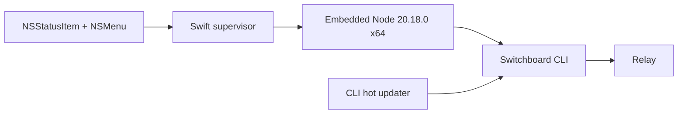

<div align="center">

# Switchboard Legacy Mac

**Switchboard for macOS Catalina — Intel x86_64, native AppKit, self-contained runtime.**

[](https://github.com/lfkdsk/switchboard-legacy-mac/actions/workflows/build.yml)
[](#compatibility)
[](#compatibility)
[](https://github.com/lfkdsk/switchboard-legacy-mac/releases)

</div>

This is a standalone Catalina port of
[`lfkdsk/Switchboard`](https://github.com/lfkdsk/Switchboard), sourced from
upstream commit [`a00cd56`](https://github.com/lfkdsk/Switchboard/commit/a00cd56a8ee765f9f695a58b66dc67732f0b7ca1).
It does not modify or replace the upstream project.

> **Prerelease:** the build is compiled and inspected in Intel macOS CI, but has
> not yet been exercised on physical macOS 10.15.7 hardware.

## Compatibility

| Requirement | Supported |
| --- | --- |
| Operating system | macOS 10.15 Catalina or newer |
| CPU | Intel x86_64 only |
| Apple Silicon | No native arm64 build |
| Runtime | Embedded Node.js v20.18.0 x64 |
| Signing | Ad-hoc; no Developer ID and no notarization |

The release workflow rejects the DMG unless the Swift app executable, embedded
Node, and every `node-pty` `pty.node` are x86_64 and report a Mach-O minimum OS
of **10.15 or earlier**.

## Install on Catalina

1. Download `Switchboard-0.1.0-Catalina-x64.dmg` from
   [Releases](https://github.com/lfkdsk/switchboard-legacy-mac/releases).
2. Open the DMG and drag **Switchboard.app** to **Applications**.
3. In Finder, open Applications, Control-click **Switchboard**, choose
   **Open**, then confirm **Open**. This manual approval is expected because the
   app is ad-hoc signed and not notarized.
4. If Catalina still blocks it, run:

   ```bash
   xattr -dr com.apple.quarantine /Applications/Switchboard.app
   open /Applications/Switchboard.app
   ```

5. Use **Sign In…** from the menu-bar menu. If remote shells need Desktop,
   Documents, or Downloads, choose **Open Full Disk Access Settings…** and add
   Switchboard.

## What remains available

- account sign-in/sign-out and saved-login auto-start;
- live connection state, host metrics, viewer status, and failure guidance;
- open dashboard and copy anonymous share URL;
- start, stop, and restart of the embedded CLI daemon;
- server, shell, and peer-command preferences;
- Full Disk Access detection and Catalina System Preferences handoff;
- Launch at Login through `~/Library/LaunchAgents`;
- `--selftest` supervisor/daemon diagnostic;
- integrity-checked npm CLI hot updates with crash rollback.



## Differences from upstream

| Upstream macOS app | This repository |
| --- | --- |
| SwiftUI `App` + `MenuBarExtra` (macOS 13+) | AppKit `NSApplicationDelegate` + native `NSMenu` (10.15+) |
| `SMAppService` login item | Per-user LaunchAgent plist |
| Sparkle app self-update | Removed; install newer DMGs manually |
| arm64 and x64 release builds | x86_64 only |
| Developer ID signing and notarization | Ad-hoc signing, no notarization |
| Avatar-rich SwiftUI header | Compact native text account header |

CLI hot updates are intentionally retained. The updater refuses dependency
changes, so changes to `node-pty` or any other dependency still require a new
DMG.

## Build and verify

On an Intel Mac:

```bash
cd macos
swift test --arch x86_64
CONFIG=release VERSION=0.1.0 BUILD_VERSION=0.1.0 scripts/make-app.sh
scripts/check-minos.sh build/Switchboard.app
```

Every push runs the same build on GitHub's `macos-15-intel` runner and uploads
the DMG plus a minos report. A `v*` tag creates a GitHub prerelease and attaches
the DMG.

## Provenance and license

The `macos/` and `cli/` snapshots came from upstream commit `a00cd56`. That
commit has no root license file (and GitHub reports no detected repository
license); its CLI package metadata declares MIT. This port is distributed under
the included [MIT License](LICENSE).
